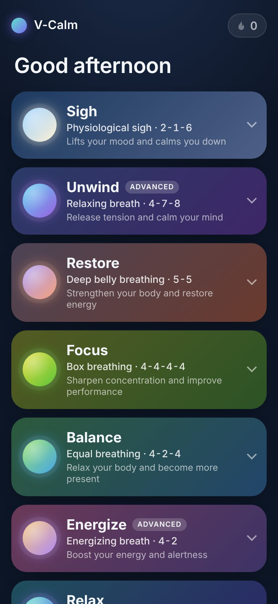
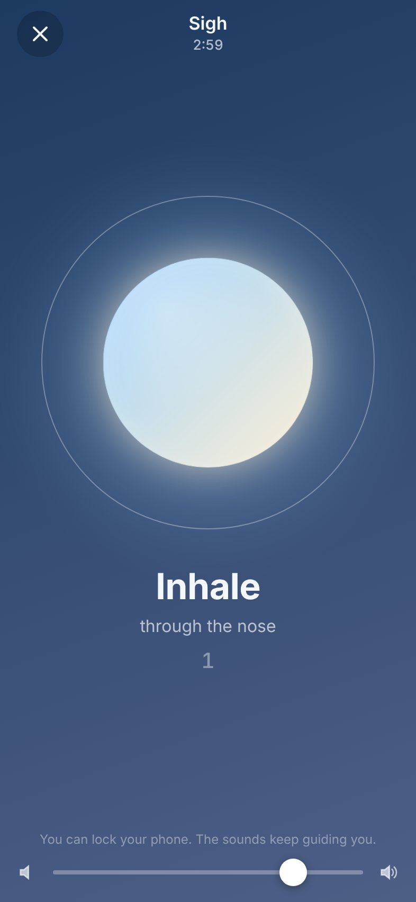
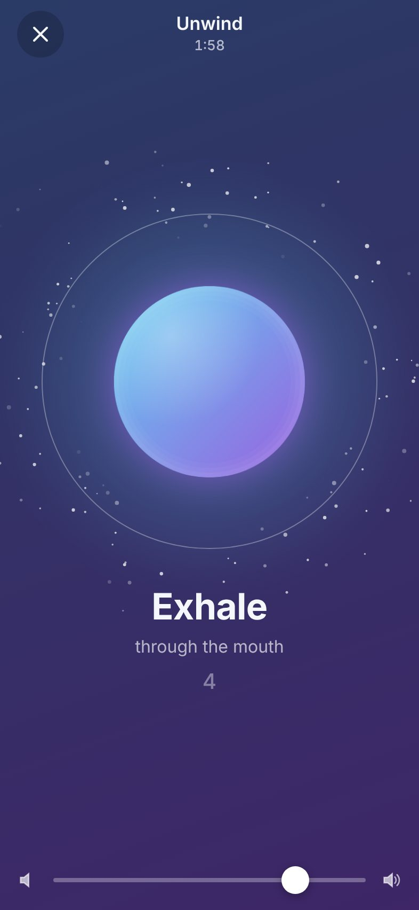

# V-Calm

**Two taps from your home screen to a calm breath.**
A tiny, offline-first breathing app (PWA) with six classic patterns and the physiological sigh. No account, no tracking: everything stays on your device.

**Live:** [breathe.viktorbezhenar.in.ua](https://breathe.viktorbezhenar.in.ua): open it on your phone and tap _Add to Home Screen_.

<p align="center">
  
  
  
</p>

## Why

I used a small breathing web app every day for months until its server was hacked and it disappeared. V-Calm is the replacement: no server code to attack, it keeps working offline, and it's quick to start.

## Features

- **Seven programs**, one tap to expand, one tap on **2 · 3 · 4 · 5 min** to start
- **Repeat last**: your usual session is one tap from the home screen
- **Phase sounds** synthesised live with Web Audio: a bell on inhale, a chime on hold, a singing bowl through the exhale. You can breathe with your eyes closed.
- **Calm orb** that fills and empties with your breath, with a soft shimmer on the exhale
- **Sessions finish the breath**: the timer rounds up to whole cycles, so you never stop mid-inhale
- **Streaks** (a day counts after 2+ min of practice), longest streak, total minutes
- **Offline** after the first visit; **installable** to the iOS/Android home screen
- **iPhone details handled**: plays with the silent switch on (Audio Session API), keeps the screen awake (Wake Lock), pauses automatically when you leave the app
- **Private by design**: no cookies, no analytics, no third-party requests, strict CSP

## Programs

| Program  | Technique            | Pattern (seconds)              | Good for                |
| -------- | -------------------- | ------------------------------ | ----------------------- |
| Relax    | Extended exhale      | in 4 · out 6                   | Stress relief           |
| Balance  | Equal breathing      | in 4 · hold 2 · out 4          | Becoming present        |
| Restore  | Deep belly breathing | in 5 · out 5                   | Energy, ~6 breaths/min  |
| Focus    | Box breathing        | in 4 · hold 4 · out 4 · hold 4 | Concentration           |
| Energize | Energizing breath    | in 4 · out 2                   | Alertness (advanced)    |
| Unwind   | Relaxing breath      | in 4 · hold 7 · out 8          | Winding down (advanced) |
| Sigh     | Physiological sigh   | in 2 · top-up in 1 · out 6     | Calming down fast       |

The **physiological (cyclic) sigh** follows the protocol in [Balban et al., 2023, _Cell Reports Medicine_](https://pmc.ncbi.nlm.nih.gov/articles/PMC9873947/): two inhales through the nose (the second a short top-up), then a slow, full exhale through the mouth, 5 minutes a day. The study prescribes no counts; 2-1-6 keeps the exhale twice as long as the inhales.

> V-Calm is a relaxation tool, not medical advice. Stop if you feel light-headed.

## Quick start

Requires Node 22+ (only for the dev server and checks; the app itself has no build step).

```bash
npm install        # dev tools only (ESLint, Prettier)
npm run dev        # http://localhost:5173 with production headers
npm test           # unit tests (node:test)
npm run check      # lint + format check + tests (what CI runs)
```

## Deploy

**Production: Cloudflare Pages** (free plan), auto-deployed on every push to `main`. See [`docs/deploy.md`](docs/deploy.md) for the one-time setup and a custom domain.

**Self-hosting: Docker**, a hardened, read-only, non-root nginx:

```bash
docker compose up -d --build   # http://localhost:8080
```

## How it works

```
app/                    ← deployed as-is (no build step)
  index.html            three screens: home, session, done
  css/app.css
  js/
    programs.js         the seven programs (data)
    timeline.js         pure timing engine: program + minutes → timed segments
    streaks.js          pure streak maths over per-day practice
    session.js          runs a session on the AudioContext clock
    audio.js            synthesised bell / chime / bowl
    main.js             UI wiring
    storage.js, wakelock.js, shimmer.js
  sw.js                 service worker: precache, cache-first, offline
  _headers              security headers (Cloudflare Pages)
docker/nginx.conf       same headers for self-hosting
test/                   node:test suites
```

- **One clock.** Sound and animation both read the Web Audio clock, so they stay locked together for the whole session. Pause suspends the AudioContext.
- **Sounds are code.** Each cue is a few sine partials with exponential decay, sized to the phase length (the exhale bowl rings for the full exhale). No audio files.
- **Data** lives in `localStorage` under `vcalm:v1` on your device. Nothing is sent anywhere.

## Releasing

1. Bump the version in `package.json`, `app/sw.js` and `app/js/main.js` (a test enforces they match).
2. Add new `app/` files to `ASSETS` in `app/sw.js` (a test enforces this too).
3. Update `CHANGELOG.md`, commit, push. Cloudflare deploys, and phones pick up the new version on their next launch.

## Roadmap

- Custom patterns
- Optional streak backup / sync across devices
- Daily reminder
- Practice calendar heatmap

## Contributing & security

Issues and PRs are welcome; run `npm run check` first. Report vulnerabilities privately; see [`SECURITY.md`](SECURITY.md).

## License

[MIT](LICENSE) © 2026 Viktor Bezhenar

Inspired by the breathing exercises in Calm and Practico. Not affiliated with either; all sounds and visuals are original.
